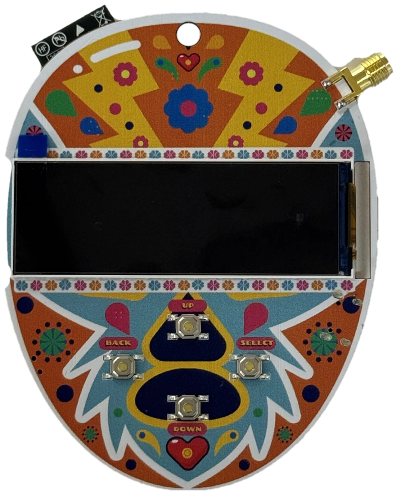
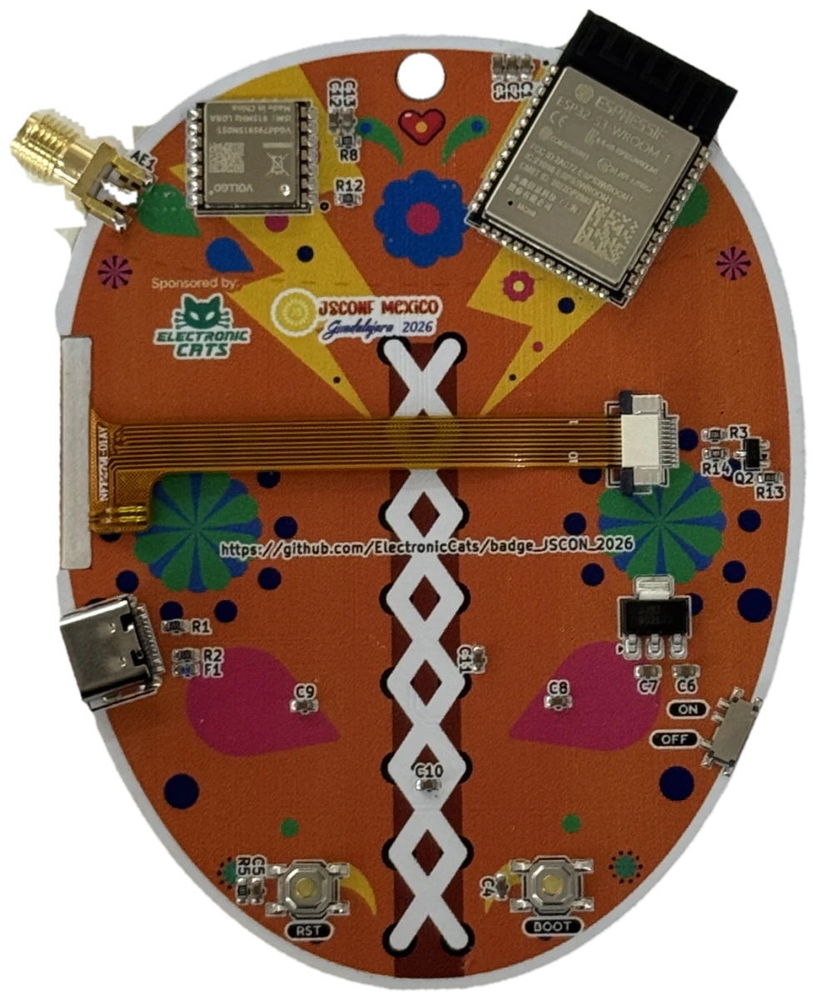

# Badge JSCONF 2026


<p align="center">
  
  
</p>

Hardware abierto del **badge de JSCONF México 2026** (Guadalajara, 29 y 30 de octubre), diseñado por [Electronic Cats](https://electroniccats.com).

Es un nodo de radio **LoRa** con pantalla a color y cuatro botones que funciona como un nodo más de una red [Meshtastic](https://meshtastic.org): sirve de gafete con tu nombre, manda mensajes de texto a otros badges sin red celular ni Wi-Fi, y trae un juego de ajolotes que se desbloquean al encontrarte con otras personas.

Este repositorio contiene el **diseño de hardware** (esquemático, PCB y huellas). El firmware, las herramientas y la presentación del taller viven en otros repositorios (ver [Proyectos relacionados](#proyectos-relacionados)).

## Características

| Elemento | Detalle |
|-|-|
| Microcontrolador | ESP32-S3-WROOM-1-N8 (8 MB de flash, sin PSRAM), USB nativo |
| Radio | Módulo LoRa de 915 MHz (LLCC68), antena por conector SMA de borde |
| Pantalla | 428 × 142 px a color, conector FFC de 10 pines |
| Botones | 4 de usuario (arriba, abajo, select, back) y un interruptor de encendido |
| Alimentación | USB-C, con fusible de 0.75 A y regulador de 3.3 V. Sin batería ni GPS |
| Conectividad | LoRa (malla), Bluetooth LE (app de Meshtastic) y USB CDC (control desde el navegador) |
| PCB | 2 capas, 1.6 mm, diseñada en KiCad 10 |

## Estructura del repositorio

```text
.
├── hardware/                        # Proyecto de KiCad
│   ├── Badge_JSCON_2026.kicad_pro
│   ├── Badge_JSCON_2026.kicad_sch   # Esquemático
│   ├── Badge_JSCON_2026.kicad_pcb   # PCB
│   ├── Footprints/                  # Huellas, símbolos y modelos 3D propios
│   ├── fp-lib-table
│   ├── electroniccats_sch.kibot.yaml
│   └── electroniccats_pcb.kibot.yaml
├── docs/images/                     # Fotos del badge para este README
└── .github/workflows/               # Generación automática de archivos de fabricación
```

## Hardware

### KiCad

El hardware se diseña en **KiCad 10** (el proyecto fue guardado con la versión 10.0). Los archivos que genera el diseño son:

- `Badge_JSCON_2026.kicad_pro`
- `Badge_JSCON_2026.kicad_pcb`
- `Badge_JSCON_2026.kicad_sch`

Los archivos temporales de KiCad los ignora Git ([archivos ignorados](.gitignore)). Todo lo del diseño va dentro de la carpeta [hardware](hardware/).

Las huellas y símbolos que no vienen en las bibliotecas estándar (módulo LoRa, pantalla, conector USB-C, antena SMA, interruptor, ESP32-S3) están en [hardware/Footprints](hardware/Footprints/) y se cargan con `fp-lib-table`.

### Componentes principales

| Ref. | Valor | Función |
|-|-|-|
| U1 | ESP32-S3-WROOM-1-N8 | Microcontrolador, Bluetooth LE y USB |
| U5 | VGdd79S915N0S1 | Módulo LoRa 915 MHz |
| U2 | BL8072CLTR33 (SOT-223) | Regulador de 3.3 V |
| P1 | USB-C (C393939) | Alimentación y datos |
| F1 | Fusible 0.75 A | Protección de entrada |
| J2 | FFC 10 pines (Hirose FH12) | Pantalla |
| Q2 | BC846 | Control de brillo de la pantalla (`LCD_BRIGHT`) |
| SW1, SW2, SW4–SW7 | Pulsadores SMD TL3342 | Cuatro botones de usuario, BOOT y EN (reset) |
| SW3 | MSK12C02 | Interruptor de encendido |
| AE1 | Conector SMA de borde | Antena LoRa |
| R1, R2 | 5.1 kΩ | Configuración del USB-C |

La lista completa de materiales (BOM) se genera automáticamente en cada release.

### Configuración de automatización

Los workflows de GitHub Actions detectan automáticamente los archivos de KiCad en `hardware/`; no hace falta modificar ningún archivo de configuración.

Buscan:
- El primer archivo `.kicad_pcb` encontrado en `hardware/`.
- El archivo `.kicad_sch` que coincida con el nombre del PCB.
- Si no hay coincidencia exacta, el primer `.kicad_sch` disponible.

**Nota**: los archivos de KiCad deben estar en la carpeta `hardware/` con sus extensiones correctas (`.kicad_pro`, `.kicad_pcb`, `.kicad_sch`).

**Workflows disponibles:**
- **DRC y ERC**: se ejecutan en cada `push` y `pull_request` para validar el diseño.
- **Archivos de fabricación**: se generan cuando se publica un `release`.

#### Activar o desactivar DRC y ERC

Están activos por defecto. Para desactivarlos, cambia estas líneas en [electroniccats_sch.kibot.yaml](hardware/electroniccats_sch.kibot.yaml):

```yaml
run_erc: false  # Cambiar a false para desactivar ERC
run_drc: false  # Cambiar a false para desactivar DRC
```

### Creación de un release

Al terminar el proyecto y su revisión se publica el release:

1. Presiona **Create a new release**.
2. Revisa la sección de **Actions**: ahí se generan los archivos.
3. Al terminar, los archivos de fabricación (Gerbers, taladros, BOM y BOM interactivo, posición de componentes, modelo STEP y PDF del esquemático y del PCB) quedan adjuntos al mismo release.

## Cómo funciona el badge

Con el firmware del taller, el badge:

- Se anuncia en las apps de Meshtastic como un nodo normal (por Bluetooth LE, con PIN de 6 dígitos que muestra la pantalla).
- Usa el preset `SHORT_FAST` en la región US, fijos. Por eso **no interopera con la malla pública** de Meshtastic, solo con otros badges del evento.
- Se puede controlar desde el navegador por USB con Web Serial (mostrar textos, pulsar botones, cambiar el nombre, subir una imagen de 428 × 142).

Los detalles del firmware, el juego de ajolotes, las páginas de la pantalla y cómo flashear un badge están en el repositorio del firmware.

## Proyectos relacionados

| Proyecto | Qué contiene |
|-|-|
| [jscon-2026-firmware](https://github.com/ElectronicCats/jscon-2026-firmware) | Firmware (fork de Meshtastic con el target `badge_jscon2026`) |
| [presentacion-jscon-2026](https://github.com/ElectronicCats/presentacion-jscon-2026) | Presentación del taller |
| [Tienda de Electronic Cats](https://electroniccats.com/store/badgejsconf-taller/) | Badge y taller de JSCONF |
| [JSCONF México](https://www.jsconf.mx/) | Evento |

## Licencia y créditos

- **Diseño de hardware:** Lizeth Gallegos Martínez, Electronic Cats (rev. v1.0).
- **Presentadores del taller:** Andrés Sabas y Heikki Isa Perea Esparza.
- **Evento:** JSCONF México 2026.

## Maintainer

<a
href="https://github.com/sponsors/ElectronicCats">


</a>

Electronic Cats invests time and resources providing this open source design, please support Electronic Cats and open-source hardware by purchasing products from Electronic Cats!
